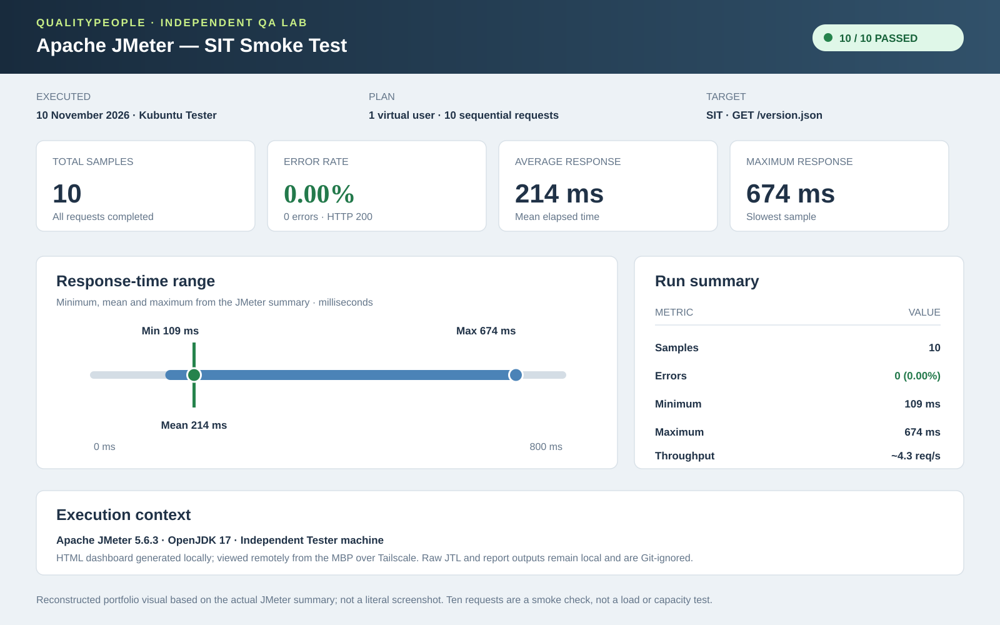

# QualityPeople engineering portfolio

**Building quality in. Proving it.**

Live portfolio: [howibuilt.qualitypeople.ie](https://howibuilt.qualitypeople.ie)  
Application: [www.qualitypeople.ie](https://www.qualitypeople.ie)  
Portfolio source: [GitHub](https://github.com/Floodzie2/qualitypeople-portfolio)  
Application source: [GitHub](https://github.com/Floodzie2/qualitypeople-app)

## Why this project exists

QualityPeople is a practical learning and portfolio project documenting how a small web application can be developed and tested with modern engineering practices. It connects hands-on implementation with a quality-engineering approach: small changes, automated feedback, explicit environments, and evidence before release.

The portfolio is intentionally transparent about what is implemented, what is planned, and what the tests have—and have not—demonstrated.

## Professional context

QualityPeople connects QA leadership experience with current hands-on engineering. After five years as Head of QA at Storyful, the project is a practical way to explore modern delivery, automation and AI quality engineering from both a leadership and implementation perspective.

While at Storyful, I experimented with early ChatGPT to turn requirements and email threads into candidate test cases. The current work builds on that idea with explicit expected behaviour, repeatable tests and measurable evaluation of AI outputs—while documenting failure modes and limitations rather than treating generated content as inherently trustworthy.

## Senior Quality Engineering operating model

The portfolio also documents the delivery model behind the technical work:

- **Shared quality ownership:** quality is built by the whole delivery team, with QE providing strategy, specialist expertise and independent challenge.
- **Risk-based testing:** prioritise critical journeys, access controls, data integrity, integrations and high-change areas rather than maximising automation percentages.
- **Early, layered feedback:** combine fast unit and static checks with API/contract tests, targeted browser smoke tests, broader SIT regression and exploratory testing.
- **Purposeful automation:** measure defect detection, feedback time, reliability and maintenance cost—not just the number of automated tests.
- **Governed AI evaluation:** use representative golden datasets, task-specific measures, baselines, adversarial cases and human review; distinguish raw model output from deterministic controls.
- **Reliable test suites:** investigate flaky failures by root cause, use quarantine only as controlled temporary containment, and track ownership through to a stable retest.

The operating model proposes outcome measures including escaped defects, feedback time, regression flakiness, risk coverage, delivery flow and AI quality. These should be baselined and interpreted together; none is a standalone proxy for quality.

My approach to Quality Engineering combines enterprise QA leadership with hands-on engineering. It connects shared quality ownership, risk-based testing, automation strategy, CI/CD, performance engineering, security and AI evaluation. QualityPeople is a working application and engineering portfolio through which I demonstrate these practices in code: automated Playwright and API checks, delivery pipelines, performance testing, defect analysis and AI evaluation. Together, my leadership experience and technical work show how I approach building quality into the delivery lifecycle.

## Follow the engineering evidence

- [Application source](https://github.com/Floodzie2/qualitypeople-app)
- [Independent QA Lab — separate test tooling and execution environment](https://github.com/Floodzie2/qualitypeople-qa-lab)
- [QA Lab foundation pull request](https://github.com/Floodzie2/qualitypeople-qa-lab/pull/1)
- [Docker Playwright runner and Kubuntu execution evidence](https://github.com/Floodzie2/qualitypeople-qa-lab/pull/2)
- [CI and deployment workflows](https://github.com/Floodzie2/qualitypeople-app/actions)
- [Merged AI triage evaluation work](https://github.com/Floodzie2/qualitypeople-app/pull/7)
- [AI evaluation methodology and experiment log](https://github.com/Floodzie2/qualitypeople-app/blob/main/docs/ai-triage-evaluation.md)

## What it covers

- **Distributed development:** a MacBook Pro acts as the VS Code control centre; an M4 Mac mini is the Developer and Ollama inference host; and a 2012 Mac mini running Kubuntu 26.04 is the independent Tester machine. VS Code Remote SSH connects to both over Tailscale.
- **Quality engineering:** TypeScript, Playwright browser automation, API checks, regression strategy and manual system-integration testing.
- **Delivery:** separate GitHub repositories and Cloudflare Pages destinations for the application and portfolio.
- **Performance engineering:** Apache JMeter 5.6.3 runs in application CI and independently from the Kubuntu QA Lab Tester against deployed SIT. Both are deliberately small smoke checks; broader load testing and AI-assisted interpretation remain planned.
- **AI quality engineering:** a protected, evaluation-only enquiry-triage endpoint tested against 12 synthetic cases, including ambiguity, conflicting dates and prompt injection.


## Independent QA Lab: developer and tester separation

A separate private repository, [qualitypeople-qa-lab](https://github.com/Floodzie2/qualitypeople-qa-lab), holds independent test tooling and execution guidance outside the application source. It targets the deployed Cloudflare Pages SIT environment; it does not contain, build or deploy the application.

The cross-machine workflow is now demonstrated:

- **Developer:** M4 Mac mini, maintaining the application and QA tooling through Git branches and pull requests.
- **Tester:** 2012 Mac mini running Kubuntu 26.04, independently pulling the QA Lab repository and executing tests.
- **Control centre:** MacBook Pro using VS Code Remote SSH over Tailscale to access both machines.
- **Git authentication:** the Kubuntu Tester uses its own GitHub SSH key with Keychain-backed agent reuse. A passphrase-free `git pull` was verified in the active login session; a fresh login may require the passphrase once.
- **Initial cross-machine Playwright baseline:** the first two deployed-SIT smoke tests passed on both M4 and Kubuntu (**2/2 on each machine**).
- **Expanded Playwright SIT suite:** all **10/10 tests passed natively** on Kubuntu in 5.4 seconds and all **10/10 passed in Docker** in 5.8 seconds using four workers on 11 November 2026.
- **Docker runner:** the Kubuntu Tester uses the official `mcr.microsoft.com/playwright:v1.64.1-noble` image through Docker Compose. The HTML report and last-run metadata were confirmed in the host workspace after the container exited.
- **JMeter:** Apache JMeter 5.6.3 ran independently on Kubuntu against the deployed SIT version endpoint (**10 samples, 0 errors**); the HTML dashboard was generated on the Tester and viewed remotely from the MBP.

The Playwright suite covers homepage response, deployment version identity, navigation and mobile layout, plus contact-form validation and mocked success/failure responses. The contact-form tests do not create real enquiries or verify backend persistence. This is targeted Chromium browser coverage, not broad regression, accessibility, security or cross-browser proof.

The QA Lab remains separate from [qualitypeople-app](https://github.com/Floodzie2/qualitypeople-app): it contains QA tooling and runbooks, not application source or deployment configuration. The Docker container packages the test runner and browser dependencies only; the application remains deployed to Cloudflare Pages and is not containerised by this workflow. Generated reports remain local to the Tester and are Git-ignored.

The foundation work is in [draft PR #1](https://github.com/Floodzie2/qualitypeople-qa-lab/pull/1). The follow-on [Docker runner change is in draft PR #2](https://github.com/Floodzie2/qualitypeople-qa-lab/pull/2), stacked on PR #1. Neither pull request has been merged.
## Local AI-assisted development: M4 Ollama and remote QA

The distributed workstation now uses the M4 Mac mini as a local AI inference host while the QualityPeople QA Lab workspace remains on the independent Kubuntu Tester. VS Code runs on the MacBook Pro and opens the Tester project through Remote SSH.

- **Inference host:** Ollama runs on the M4 Mac mini.
- **Available models:** `qwen3.5:4b` (approximately 4.0 GB) for general assistance and `qwen2.5-coder:7b` (approximately 4.7 GB) for coding-focused work.
- **Editor and workspace:** VS Code on the MacBook Pro connects to the Kubuntu QA Lab workspace over Remote SSH. The Ollama extension is enabled in the SSH environment.
- **Agent compatibility:** BYOK models are not supported in remote GitHub Copilot sessions. The working configuration uses VS Code's local agent harness for Ollama/BYOK sessions; GitHub Copilot remains available separately.
- **Private network:** Tailscale provides connectivity between the machines, including when they are on different networks.
- **API forwarding:** an SSH local port forward makes the M4's Ollama API available as `http://127.0.0.1:11434` on Kubuntu. Ollama remains bound to the M4's loopback interface rather than being exposed directly to the wider network.

The connection was verified from Kubuntu by requesting `/api/tags` through the tunnel and receiving both installed model entries. This confirms that the Tester can reach the M4-hosted Ollama service; inference itself takes place on the M4. The SSH forwarding session must be active when this route is used.

This is a development-assistance path, not part of the automated test execution path. Playwright and JMeter continue to run on their designated machines, and AI-generated suggestions remain subject to normal review and test evidence.

## JMeter smoke-test evidence

A focused application pull request adds Apache JMeter 5.6.3 to CI. The test starts the built application locally and sends ten read-only requests to `GET /version.json` with one virtual user. It checks for HTTP 200 and a `commitSha` field, fails the workflow if any sample fails, and uploads the generated HTML dashboard and raw JTL results as a 14-day GitHub Actions artifact.

- [Focused JMeter CI pull request](https://github.com/Floodzie2/qualitypeople-app/pull/10)
- [Successful feature-branch CI run and report artifact](https://github.com/Floodzie2/qualitypeople-app/actions/runs/40385523665)

The CI run completed 10 samples with **0 errors**. Its reported mean was **7.5 ms**, median **3 ms**, and maximum **50 ms** for that short local-preview run. These figures describe that specific run, not a stable performance baseline.

A separate manual SIT verification on 26 October 2026 also completed 10 requests with **0 errors**. Its report showed a **159.7 ms mean**, **131.5 ms median**, **99 ms minimum**, and **479 ms maximum**. The portfolio's dashboard image is a labelled reconstruction of those summary statistics, not a literal screenshot of JMeter's HTML page. The reported **6.165 requests/second** is from this brief run and must not be treated as a capacity result.

### Independent QA Lab JMeter run — 10 November 2026

The 2012 Kubuntu Tester ran the QA Lab's `performance/jmeter/sit-smoke.jmx` plan using **Apache JMeter 5.6.3** against the deployed SIT endpoint. The plan used one virtual user and ten sequential GET requests to `/version.json`, with HTTP 200 and response-body assertions.

- **Samples:** 10
- **Errors:** 0 (0.00%)
- **Mean response:** 214 ms
- **Minimum:** 109 ms
- **Maximum:** 674 ms
- **Throughput:** approximately 4.3 requests/second for this short run

The HTML dashboard and raw JTL results were generated on Kubuntu, then the dashboard was viewed in Brave on the MBP over Tailscale. The generated report directory and JTL file are Git-ignored; the Tester execution and summary were recorded in the QA Lab [draft PR #1](https://github.com/Floodzie2/qualitypeople-qa-lab/pull/1).



*The image is a labelled reconstruction of the actual JMeter summary, not a literal screenshot. The run is a small endpoint smoke check—not a load, stress or capacity test. Ten samples are insufficient for a stable performance baseline, and the reported throughput must not be interpreted as system capacity.*

This is currently a smoke test for endpoint availability and basic response behaviour—not a load, stress or capacity test. Scheduled load profiles, historical trend comparisons and AI-assisted result analysis are future work. Any AI analysis should be evaluated against the raw results and human-reviewed before conclusions are accepted.

## What the AI evaluation metrics mean

The initial run passed every check in just 1 of 12 cases. The individual metrics explain why:

- **Schema validity (100%) — Is the response well-formed?** Every output matched the expected structured format and field types. This checks shape, not truth or usefulness.
- **Category accuracy (66.7%) — Did it classify the enquiry correctly?** Roughly two-thirds of the 12 cases received the expected category, such as a booking request or a pricing enquiry.
- **Summary anchor coverage (46.4%) — Did the summary preserve the important facts?** The evaluator checks for expected factual anchors, such as event type, date, venue and time. This score means fewer than half of the expected anchors were found in the summaries.
- **Missing-information recall (25.0%) — Did it identify the details still needed?** Of the follow-up details marked as necessary in the reference cases, the model identified only one-quarter. For a booking, that might mean noticing that the date, location or budget still needs to be confirmed.
- **Human-review accuracy (91.7%) — Did it know when a person should review the case?** The review/no-review decision matched the expected decision in 11 of 12 cases.

These metrics measure different things. A response can be perfectly valid JSON yet put an enquiry in the wrong category, omit key facts or fail to ask for essential details. That is why the evaluation uses multiple checks rather than treating schema validity as overall quality.

## AI evaluation: latest local findings

The latest local v13 evaluation passed **12 of 12 synthetic cases** on the final API result. The evaluator reports 100% schema validity, category accuracy, summary-anchor coverage, missing-information recall and human-review accuracy across this dataset.

The raw model result is reported separately: it passed **11 of 12 cases**, with missing-information recall of **91.7%**. The remaining raw-model miss was a conflicting-date case where the model omitted the confirmed event date from its follow-up requirements. A narrow deterministic safety override adds that detail to the final result. Reporting both outputs keeps the model's limitation visible and avoids presenting a post-processing improvement as a model improvement.

### Latest local coverage snapshot

A later V8 coverage inspection produced a **partial report across seven instrumented files**, not a whole-application coverage result. Statement coverage in that snapshot was:

- Cloudflare AI endpoint (`functions/api/ai-triage.ts`): **63.8%**
- Main application component (`src/App.tsx`): **41.7%**
- AI evaluator (`src/ai/enquiry-evaluator.ts`): **96.4%**
- AI safety checks (`src/ai/enquiry-safety.ts`): **93.8%**
- Golden evaluation cases and triage logic: **100% each**
- `src/App.css`: no executable statements to measure

This replaces the earlier 77.9% aggregate figure in this portfolio: the newer report is partial and should not be presented as total application coverage. Coverage measures executed statements, not test effectiveness or correctness. The endpoint and main application component remain useful targets for additional tests.

### What this does—and does not—show

The result demonstrates a functioning evaluation harness, explicit expected behaviour, case-level diagnostics, evaluator tests and a deterministic control for one known conflict-date failure. It does **not** establish 100% real-world accuracy: the dataset contains only 12 synthetic cases, the results are from a local run, and the current scoring criteria have defined limits.

Next work is to expand the golden dataset, exercise endpoint failure paths and safety boundaries, and validate the feature through broader application journeys. The protected evaluation endpoint is not connected to public enquiry submission and the dataset contains no live customer data.

## Run the portfolio locally

Requirements: a current Node.js release and npm.

```bash
git clone https://github.com/Floodzie2/qualitypeople-portfolio.git
cd qualitypeople-portfolio
npm install
npm run dev
```

Useful checks before publishing:

```bash
npm run typecheck
npm run lint
npm run build
```

## Architecture and publishing

The portfolio and application are maintained in separate repositories and deployed independently to Cloudflare Pages. Changes should be made on a branch, reviewed in a pull request, and published only after the relevant checks and preview have been reviewed.

## Guiding principle

**Evidence over claims.** A passing build shows that the site builds; automated tests provide evidence about specific behaviours; neither should be presented as proof of qualities they do not measure.
